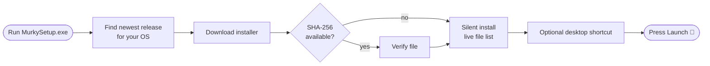

<div align="center">

<picture>
  <source media="(prefers-color-scheme: dark)" srcset="logo_light.png">
  
</picture>

# Murky Installer

**One tiny download. One click. A faster, quieter browser.**

[](#-install)
[](#-linux)
[](#-whats-inside)
[](#-build-it-yourself)

[**Download**](https://github.com/murkybrowser/Murky-Browser/releases) · [**Website**](https://murkybrowser.xyz) · [**Browser source**](https://github.com/murkybrowser/Murky-Browser) · [**Donate**](https://murkybrowser.xyz/donate)

</div>

---

## ✨ What is this?

This is the **official web installer for Murky Browser**. It is a small native app that finds the **newest Murky release**, downloads it, checks it, installs it, and hands you a **Launch** button.

No bundled old version. No stale download. You always get the latest Murky.

---

## 🚀 Features

| | Feature | What it does |
|---|---|---|
| 🪶 | **Featherweight** | The installer itself is only ~100 KB. Murky is downloaded fresh when you run it. |
| 🔄 | **Always the latest** | Reads the GitHub releases and picks the newest stable build for your OS. |
| 🔐 | **Verified downloads** | Checks the SHA-256 checksum whenever GitHub provides one, so a corrupted file never gets installed. |
| 🤫 | **Silent install** | No clicking through wizard pages. Just watch it go. |
| 📂 | **Live file list** | See exactly which files are being installed, not a vague megabyte counter. |
| 🖥️ | **Desktop shortcut** | A **Create a Desktop Shortcut** checkbox, checked by default. Untick it if you'd rather not. |
| 🎯 | **You decide when it opens** | Murky never starts by itself. It launches only when you press **Launch**. |
| 🌗 | **Smooth, modern UI** | Rounded borderless window, animated buttons that react when you press them, and a clean progress bar. |
| 🐧 | **Windows and Linux** | Native window on Windows, a no-window script for Linux. |
| 📜 | **Clear legal links** | Terms of Service and Privacy Policy are one click away. |

---

## 🧠 How it works



- Releases are chosen **per OS**, so a newer Windows release never hides the latest Linux one, and the other way round.
- The **Windows** build downloads the `Setup` `.exe`. The portable version is never used.
- Drafts and pre-releases are skipped.

---

## 📦 Install

### 🪟 Windows

1. Download **`MurkySetup.exe`** from the [Releases](https://github.com/murkybrowser/Murky-Browser/releases) page.
2. Double-click it.
3. Wait for the progress bar to finish, keep or untick **Create a Desktop Shortcut**, and press **Launch**.

> [!NOTE]
> The installer is not code-signed yet, so Windows SmartScreen may show a warning. Choose **More info → Run anyway**.

### 🐧 Linux

Run the script. All it needs is `curl`.

```bash
sh murky-install-linux.sh
```

It downloads the latest `.AppImage` to `~/.local/share/murky`, makes it executable, and adds **Murky** to your app menu.

Prefer a window? Run the Windows installer under Mono (best effort):

```bash
mono MurkySetup.exe
```

### 🍎 macOS

Not supported yet. The installer will tell you so.

---

## ⌨️ Keyboard shortcuts

| Key | Action |
|:---:|---|
| `Enter` | Press **Launch** or **Retry** |
| `Space` | Toggle **Create a Desktop Shortcut** |
| `Esc` | Close the window (disabled while installing) |

---

## 🛠️ Build it yourself

You don't need Visual Studio or the .NET SDK. Windows already ships with the C# compiler.

```bat
build.bat
```

You get `MurkySetup.exe` (~100 KB) in the same folder. That's the file you hand out.

### ⚙️ Settings

Open the top of `MurkyInstaller.cs` and edit the `Config` class:

| Setting | Purpose |
|---|---|
| `Owner` / `Repo` | The GitHub repository to read releases from |
| `TermsUrl` / `PrivacyUrl` | Where the two legal links open |
| `WindowsTagSuffix` / `LinuxTagSuffix` | Tag endings used to pick the right release |

### 🏷️ Release requirements

For the installer to find your builds, your GitHub releases need:

- a tag ending in **`Windows`** (for example `2.0.0-Windows`) with the NSIS **Setup** `.exe` attached
- a tag ending in **`Linux`** (for example `2.0.0-Linux`) with the **`.AppImage`** attached

---

## 📁 What's inside

```
murky-installer/
├── MurkyInstaller.cs          # the whole installer, one file
├── build.bat                  # compiles it with the compiler built into Windows
├── murky-install-linux.sh     # Linux, no window
├── app.manifest
├── murky.ico
├── logo_light.png
├── logo_dark.png
└── README.md
```

---

## ❓ FAQ

<details>
<summary><b>Why is the installer so small?</b></summary>

It doesn't contain Murky. It only fetches the newest version from GitHub and installs it, so the file you share never goes out of date.

</details>

<details>
<summary><b>Is it safe?</b></summary>

The installer only talks to GitHub, and it verifies the SHA-256 checksum of the download whenever GitHub provides one. The source is a single readable file, so you can check it yourself.

</details>

<details>
<summary><b>It says it couldn't reach GitHub.</b></summary>

Check your internet connection and press **Retry**.

</details>

<details>
<summary><b>Does it open Murky without asking?</b></summary>

No. Murky only starts when you press **Launch**.

</details>

---

## ⚠️ Stay safe

The only official Murky website is **[murkybrowser.xyz](https://murkybrowser.xyz)**. Be careful with websites claiming to be Murky.

---

## 💛 Support Murky

Murky is open source and grows with your help. If you like it, [**consider donating**](https://murkybrowser.xyz/donate). Every donation is appreciated!

<div align="center">

<sub>Made with care by the Murky team</sub>

</div>
